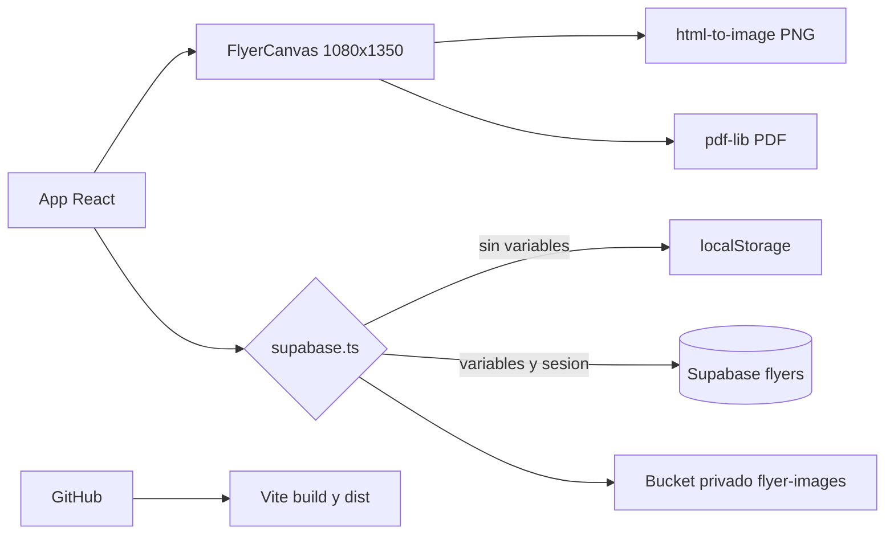

# Generador Institucional de Flyers - UASD Centro San Pedro de Macoris

Documento central del proyecto. Leer antes de modificar codigo. Ultima auditoria documental: 2026-10-12. Ultimo commit verificado: [`784f306`](https://github.com/uasd-spm/UASDSPM-POSTGRADO/commit/784f306) `Fix flyer footer layout collisions`.

## Identidad y alcance

La aplicacion permite crear, guardar, recuperar, duplicar, eliminar y exportar flyers de posgrado UASD. El objetivo es reutilizar una plantilla institucional de 1080 x 1350 basada en `Modelo.png`. El panel funciona en navegador; el flyer mantiene una composicion fija y se escala proporcionalmente en la vista previa.

- Institucion: Universidad Autonoma de Santo Domingo, Centro San Pedro de Macoris.
- Frontend: React 19, TypeScript, Vite 6 y CSS personalizado. Tailwind/PostCSS estan configurados, pero el lienzo actual usa CSS propio.
- Datos: Supabase Auth, PostgreSQL y Storage privados cuando se configuran variables; `localStorage` cuando no se configuran.
- Publicacion: GitHub `uasd-spm/UASDSPM-POSTGRADO`, rama `main`, Netlify.
- Entorno local auditado: Windows sin Node/npm instalado. La compilacion local no fue verificada en este equipo.

## Funcionamiento

`CREAR` edita identificacion, facultad, colores, programa, requisitos, fotografia, QR, importe y contacto. `CREACIONES` busca por nombre y ofrece editar, duplicar y eliminar. El guardado usa Supabase si existe configuracion y sesion; en otro caso usa almacenamiento local de un solo navegador. PNG se genera con `html-to-image`; PDF incrusta ese PNG mediante `pdf-lib`.

## Mapa esencial

| Ruta | Funcion |
|---|---|
| `src/App.tsx` | UI, formulario, biblioteca, `FlyerCanvas`, exportacion y comprobacion DOM de colisiones. |
| `src/styles.css` | Panel y composicion fija del flyer. |
| `src/data.ts` | Catalogo Vite de facultades y valores iniciales. |
| `src/supabase.ts` | Adaptador local/Supabase y carga de Storage. |
| `src/types.ts` | Tipos `Flyer` y `Faculty`. |
| `supabase/schema.sql` | Tabla, trigger y politicas RLS/Storage. |
| `Modelo.png` | Referencia visual definitiva, 1080 x 1350. |

## Sistema visual

El canvas usa `Modelo.png` como referencia, `Header Nav.svg` para el encabezado y SVG de `Loguitos/` para facultades. Carga Gotham Book/Bold/Black y OLDENGLISH UASD por `@font-face`. `TrajanPro` y otras fuentes existen como recursos, pero no estan declaradas por el CSS actual. Los colores tematicos vienen de `Flyer.primary` y `Flyer.secondary`; el negro de contactos y el azul institucional no se deben tematizar. Ver [docs/FLYER_TEMPLATE.md](docs/FLYER_TEMPLATE.md) y [docs/DESIGN_SYSTEM.md](docs/DESIGN_SYSTEM.md).

## Reglas no negociables

1. No alterar `Logo.svg` ni los recursos institucionales originales.
2. No sustituir el texto institucional por fuentes genericas.
3. No reemplazar logos SVG de facultad por texto cuando el SVG incluya su identificacion.
4. No tematizar textos, iconos o contactos negros fijos.
5. No reorganizar internamente el flyer con media queries.
6. Mantener el maestro en 1080 x 1350.
7. Conservar la composicion institucional; usar `Modelo.png` para decisiones visuales.
8. Hacer que vista previa, PNG y PDF partan del mismo `FlyerCanvas`.
9. No romper CRUD, RLS o persistencia al editar la plantilla.
10. No incluir secretos, `.env`, `node_modules` ni `dist` en Git.

## Estado real

| Area | Estado | Evidencia o limite |
|---|---|---|
| Formulario, biblioteca y operaciones locales | Implementado | `App.tsx` y `supabase.ts`. |
| Supabase Auth/DB/Storage | Implementado, pendiente de entorno real | Requiere variables, bucket y SQL ejecutado. |
| PNG/PDF | Implementado, pendiente de prueba renderizada | Ambos exportan el mismo nodo DOM. |
| Plantilla 1080 x 1350 | Implementada | CSS fijo y `FlyerCanvas`. |
| Colisiones inferiores | Implementado, pendiente de ejecucion DOM | `data-collision-count` y `console.error`. |
| Fidelidad pixel-perfect | Pendiente de validacion | No existe comparacion de PNG renderizado contra el modelo. |
| Pruebas automatizadas | No implementadas | No hay archivos de test. |
| Build local | No verificado | Node/npm no estan disponibles en el equipo auditado. |

## Problemas actuales prioritarios

- La fidelidad visual y las exportaciones no se han comprobado mediante captura/diferencia real.
- La plantilla fue ajustada por coordenadas, pero requiere inspeccion del despliegue para confirmar tipografia, degradados y limites de texto.
- Solo Humanidades tiene colores especificos en el catalogo; las demas facultades comparten colores genericos.
- `package-lock.json` no existe.
- Las imagenes eliminadas de un flyer no se eliminan del bucket; los URL firmados expiran tras una hora.

## Artefactos guardados

Guardar un flyer ahora genera PNG y PDF desde el mismo canvas, los guarda en rutas permanentes por diseno y registra `png_path`/`pdf_path`. La biblioteca usa el PNG almacenado como miniatura y permite abrir/descargar ambos archivos. Esto requiere ejecutar la migracion SQL y politica Storage `update`; la prueba remota sigue pendiente.

## Codigo QR

El campo **Enlace del codigo QR** valida URL absoluta HTTP/HTTPS y genera un QR negro sobre blanco con correccion alta en el navegador. El modo `url` se guarda como enlace y se regenera; subir una imagen activa el modo `image`. La generacion se espera antes de crear PNG/PDF. Falta prueba con camara y exportacion real.

## Continuacion segura

1. Leer este archivo y [AGENTS.md](AGENTS.md).
2. Consultar [docs/KNOWN_ISSUES.md](docs/KNOWN_ISSUES.md) y el documento tecnico del area afectada.
3. Inspeccionar codigo real y `git status` antes de editar.
4. Tras cambios importantes, actualizar este archivo, el documento tecnico, `docs/CHANGELOG.md`, problemas y roadmap segun corresponda.
5. Ejecutar o registrar las pruebas que no sea posible ejecutar.

Indice: [Arquitectura](docs/ARCHITECTURE.md) | [Plantilla](docs/FLYER_TEMPLATE.md) | [Componentes](docs/COMPONENTS.md) | [Base de datos](docs/DATABASE.md) | [Despliegue](docs/DEPLOYMENT.md) | [Pruebas](docs/TESTING.md) | [Mantenimiento](docs/MAINTENANCE.md).

Auditoria de exportacion y nitidez: [docs/RENDERING_AUDIT.md](docs/RENDERING_AUDIT.md).
